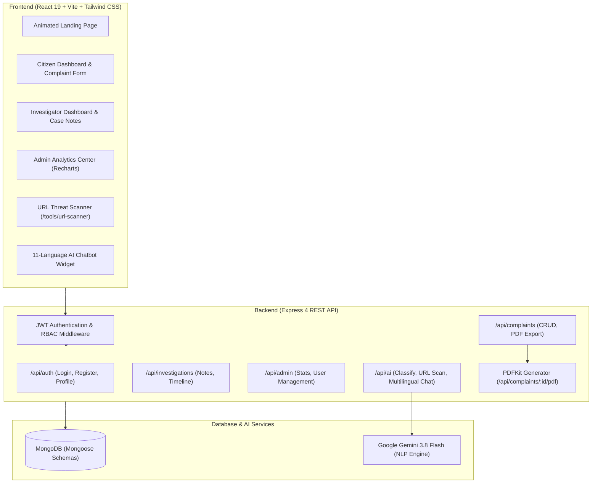

# 🛡️ CyberShield — AI-Powered Cybersecurity & Incident Management Platform

<p align="center">
  
  
  
  
  
  
</p>

---

## 📌 Executive Summary

**CyberShield** is an enterprise-grade, **AI-powered cybercrime redressal and threat intelligence platform** designed for citizens, cybersecurity investigators, and law enforcement agencies. 

Unlike traditional static complaint portals, CyberShield integrates **Google Gemini 3.8 Flash NLP**, **real-time heuristic URL threat scanning**, an **11-language Indian AI assistant**, **interactive visual analytics**, and **automated PDF forensic incident reporting** to drastically reduce incident response times and bridge the digital divide for Indian citizens.

---

## 🚀 Key 2026 Advanced Features

### 1. 🤖 AI Complaint Auto-Classification (Gemini 3.8 Flash)
* **Natural Language Processing (NLP)**: Automatically analyzes user-submitted incident narratives.
* **Instant Triage**:
  * Detects crime category (Financial Fraud, Phishing, Online Harassment, Ransomware, Identity Theft, etc.).
  * Calculates severity score (1–10) and assigns priority (`Critical`, `High`, `Medium`, `Low`).
  * Extracts threat indicators and key entities (phone numbers, UPI IDs, bank names, scam URLs).
  * Auto-populates the complaint form, eliminating user confusion.

### 2. 🔍 Real-Time Phishing & URL Threat Scanner (`/tools/url-scanner`)
* Standalone and integrated scanner accessible to all citizens and investigators.
* Real-time heuristic and domain reputation analysis.
* Evaluates typosquatting, deceptive institutional keywords, blacklisted TLDs, and credential harvesting vectors.
* Outputs a **0–100 Risk Score Bar**, threat breakdown, and defensive mitigation guidance.

### 3. 🇮🇳 11-Language Indian AI Cybersecurity Chatbot
* Floating assistant powered by Google Gemini with resilient fallback handling.
* **Full Multi-Lingual Support** with native UI switching:
  * **English**, **हिन्दी (Hindi)**, **Hinglish**, **मराठी (Marathi)**, **বাংলা (Bengali)**, **தமிழ் (Tamil)**, **తెలుగు (Telugu)**, **ગુજરાતી (Gujarati)**, **ಕನ್ನಡ (Kannada)**, **മലയാളം (Malayalam)**, **ਪੰਜਾਬੀ (Punjabi)**.
* Dynamic localized quick prompts (e.g. *“UPI se paise kat gaye kya karu?”*, *“ऑनलाइन फ्रॉड की शिकायत कैसे करें?”*).
* Direct integration of emergency safety workflows (National Cyber Helpline **1930** and bank freeze protocols).

### 4. 📊 Visual Analytics Control Center (Recharts)
* Replaces legacy tables with interactive charts:
  * **Donut / Pie Chart**: Live crime category distribution.
  * **Bar Chart**: Complaint status lifecycle breakdown.
  * **Gradient Area Chart**: Monthly crime volume vs. resolution trends.

### 5. 📄 Official PDF Incident Report Generation (`pdfkit`)
* Generates legal-ready PDF receipts for citizens and forensic case summaries for investigators.
* Features official government-style header, tracking ID badge, complainant details, chronological incident narrative, and legal disclaimer.

### 6. 🎬 Modern High-Tech Animated Landing Page
* Built with **Framer Motion**: animated hero section, dynamic counters (2,400+ Users, 650+ Cases), workflow steps, testimonials, and one-click access to threat tools.

---

## 🏛️ System Architecture



---

## 👥 4-Member Team Role Division (Presentation Ready)

| Member | Focus Area | Key Responsibilities & Code Delivered |
|---|---|---|
| **Member 1** | **Frontend Engineering & UI/UX** | Built React 19 UI, Framer Motion Landing Page, Recharts visual analytics, multi-step complaint forms, and responsive navigation layouts across 3 dashboards. |
| **Member 2** | **Backend & AI Architecture** | Express REST APIs, Google Gemini 3.8 Flash integration (`aiController.js`), multi-model fallback engine, phishing URL scanner, and multilingual chatbot engine. |
| **Member 3** | **Database & PDF Reporting** | MongoDB database design, Mongoose models, data indexing optimization, seeder script, and automated PDF document generation using `pdfkit`. |
| **Member 4** | **Auth, Security & Operations** | JWT authentication, bcrypt password hashing, RBAC (Citizen/Investigator/Admin), CORS/Helmet headers, rate limiting, and the root `start.bat` deployment automation. |

---

## 🔑 Demo Credentials

| Role | Email | Password | Permissions |
|---|---|---|---|
| **Citizen** | `citizen@demo.com` | `password123` | File complaints, AI auto-classify, download PDF, chat |
| **Investigator** | `investigator@demo.com` | `password123` | Manage assigned cases, add notes, update status, export PDF |
| **Admin** | `admin@demo.com` | `password123` | System analytics charts, user management, complaint assignment |

---

## ⚡ Quick Start Guide

### Prerequisites
- **Node.js** (v18 or higher)
- **MongoDB** running locally (`mongodb://localhost:27017/cybershield`)

### Option A: One-Click Launch (Recommended)
Double-click **`start.bat`** in the project root:
```
C:\Users\Lenovo\OneDrive\Desktop\Dokumen\cybershield\start.bat
```
This automatically launches both backend (port 5000) and frontend (port 5173) in separate windows.

### Option B: Manual Terminal Launch
```bash
# Terminal 1: Backend
cd server
npm run dev

# Terminal 2: Frontend
cd client
npm run dev
```

Open your browser at: **`http://localhost:5173`**

---

## 🎤 Presentation & Viva Q&A Cheat Sheet

### Q1: "How is this project different from traditional complaint portals?"
> *"Traditional portals are passive record-keepers. CyberShield acts as an active intelligence layer. It uses Google Gemini 3.8 Flash to auto-classify cybercrime types and calculate threat severity scores upon submission, provides real-time phishing URL risk scanning, speaks 11 Indian regional languages to assist non-English speakers, and produces court-admissible PDF incident reports."*

### Q2: "What happens if the Google Gemini API has a high-demand spike or outage?"
> *"We engineered an automatic multi-model fallback pipeline that tries Gemini 3.8 Flash, Gemini Flash Latest, and Gemini 2.5 Flash Lite. Furthermore, we implemented a local cybersecurity knowledge base so the portal continues to deliver emergency response steps (1930 helpline, bank freeze protocols) with 100% uptime even if external APIs are unreachable."*

### Q3: "How is user data and role separation enforced?"
> *"Every API route is guarded by JWT authentication middleware and Role-Based Access Control (RBAC). Citizens can only view and export their own complaints, investigators access only assigned cases, and administrators have control over system analytics and user management."*

---

## 📜 License
Developed as an Advanced Capstone Project by Peeyoosh Kangle & Team (2026).
